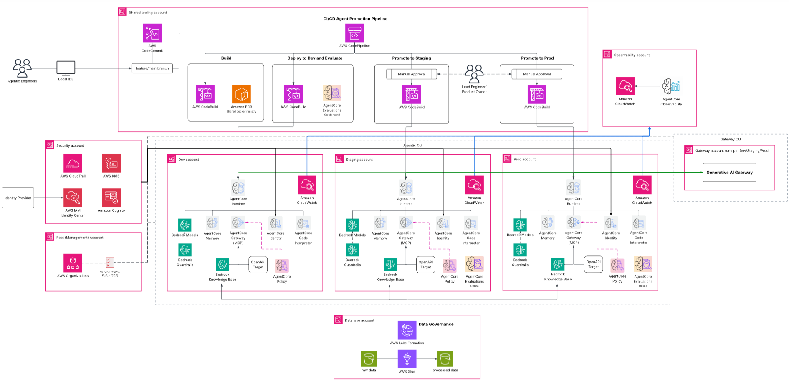

<!-- Copyright Amazon.com, Inc. or its affiliates. All Rights Reserved. -->
<!-- SPDX-License-Identifier: MIT-0 -->

# Guidance for Enterprise Agentic AI Platform on AWS

## Table of Contents

1. [Overview](#overview)
    - [Architecture](#architecture)
    - [Cost](#cost)
    - [Sample Cost Table](#sample-cost-table)
2. [Prerequisites](#prerequisites)
    - [Operating System](#operating-system)
    - [Third-party tools](#third-party-tools)
    - [AWS account requirements](#aws-account-requirements)
    - [aws-cdk bootstrap](#aws-cdk-bootstrap)
    - [Supported Regions](#supported-regions)
3. [Deployment Steps](#deployment-steps)
4. [Deployment Validation](#deployment-validation)
5. [Running the Guidance](#running-the-guidance)
6. [Next Steps](#next-steps)
7. [Cleanup](#cleanup)
8. [FAQ, known issues, additional considerations, and limitations](#faq-known-issues-additional-considerations-and-limitations)
9. [Revisions](#revisions)
10. [Notices](#notices)
11. [Authors](#authors)

## Overview

Multi-account platform for deploying AI agents at enterprise scale using [Amazon Bedrock AgentCore](https://aws.amazon.com/bedrock/agentcore/). Organizations building production AI agents face challenges around secure multi-account isolation, repeatable deployments, evaluation gates, and centralized observability. This Guidance provides an opinionated, deploy-ready platform that solves these concerns out of the box — shipping a reference Strands agent, Gateway tool integration, conversation memory, Code Interpreter, and an end-to-end CI/CD promotion pipeline across dev, staging, and prod accounts.

### Key Capabilities

- **Single and multi-account deploy** — One script, two tiers: PoC-friendly single-account and production-grade 7-account enterprise.
- **CI/CD promotion** — CodeCommit → CodePipeline → CodeBuild pipeline scaffolded out of the box, promoting agents dev → staging → prod with automated evaluation gates.
- **Pluggable agents** — Drop a new pattern into `agentcore/patterns/` and the deploy script scaffolds the repo, Docker image, Gateway tools, and eval cases for it.
- **Built-in evaluation** — AgentCore's native evaluators (Helpfulness, GoalSuccessRate) run against every agent on every deploy; configurable per-agent eval cases live alongside the agent code.
- **Centralized observability** — CloudWatch metrics, logs, and X-Ray traces aggregated across accounts via CloudWatch OAM (enterprise).
- **Secure by default** — JWT auth for end users, OAuth2 M2M between Runtime and Gateway via AgentCore Identity Token Vault, SCPs, KMS, and org-wide CloudTrail (enterprise).
- **Pay-per-use** — No always-on compute. Runtime scales to zero, tools are Lambda, memory is DynamoDB on-demand.

### What the platform deploys

- **Amazon Cognito** — User Pool with JWT authentication for end users and OAuth2 Client Credentials for M2M auth between Runtime and Gateway
- **AgentCore Runtime** — Containerized Strands agent with multi-turn conversations and tool orchestration
- **AgentCore Identity** — Token Vault and OAuth2 Credential Provider for secure M2M authentication
- **AgentCore Gateway** — MCP-protocol gateway exposing Lambda-based tools with JWT authorization
- **AgentCore Memory** — Conversation history with session summarization
- **AgentCore Code Interpreter** — Secure Python code execution in an isolated sandbox
- **CI/CD Pipeline** — CodeCommit + CodePipeline + CodeBuild for agent promotion (enterprise)
- **Observability** — CloudWatch Logs, Metrics, and AWS X-Ray tracing, aggregated via CloudWatch OAM (enterprise)

### Architecture



The platform deploys a layered architecture across multiple AWS accounts:

1. A **management account** orchestrates provisioning via CloudFormation StackSets.
2. A **shared-tooling account** hosts CI/CD pipelines (CodePipeline, CodeBuild), Amazon Cognito, and the CodeCommit agent repo.
3. **Workload accounts** (dev, staging, prod) each run isolated AgentCore stacks — Runtime, Gateway, Memory, and Code Interpreter.
4. Cross-account **observability** is aggregated via CloudWatch OAM into a dedicated observability account.
5. **Security controls** (CloudTrail, SCPs, KMS) are centralized in a security account.

For the single-account tier, all components collapse into a single account for rapid prototyping.

### Cost

You are responsible for the cost of the AWS services used while running this Guidance. As of June 2026, the cost for running this Guidance with the default settings in the EU (Ireland) region depends on your deployment tier and usage patterns.

We recommend creating a [Budget](https://docs.aws.amazon.com/cost-management/latest/userguide/budgets-managing-costs.html) through [AWS Cost Explorer](https://aws.amazon.com/aws-cost-management/aws-cost-explorer/) to help manage costs. Prices are subject to change. For full details, refer to the pricing webpage for each AWS service used in this Guidance.

### Sample Cost Table

The following table provides a sample cost breakdown for deploying this Guidance with the default parameters in the EU (Ireland) Region for one month (single-account tier, light usage — ~1,000 agent invocations/month).

| AWS service | Dimensions | Cost [USD] |
| ----------- | ------------ | ------------ |
| Amazon Bedrock (Claude Haiku) | ~1,000 invocations, ~500 input/output tokens each | ~$1.25/month |
| Amazon Bedrock AgentCore Runtime | ~1,000 invocations, pay-per-request | ~$0.50/month |
| Amazon Bedrock AgentCore Gateway | ~2,000 tool calls (2 per invocation) | ~$0.20/month |
| Amazon Bedrock AgentCore Memory | ~1,000 sessions stored | ~$0.10/month |
| Amazon Cognito | Up to 10,000 MAUs (free tier) | $0.00 |
| AWS Lambda (Gateway tools) | ~2,000 invocations, 128 MB, <1s | ~$0.00 |
| Amazon DynamoDB (on-demand) | ~2,000 read/write units | ~$0.01/month |
| AWS CloudWatch | Logs, metrics, traces | ~$3.00/month |
| **Total (single-account, light usage)** | | **~$5.06/month** |

> **Note:** Enterprise tier adds cross-account CloudWatch OAM, CodePipeline, CodeBuild, and CodeCommit costs. Costs scale linearly with agent invocations and model token usage.

## Prerequisites

### Operating System

These deployment instructions are optimized to best work on **macOS** or **Amazon Linux 2023**. Deployment on Windows may require additional steps (e.g., using WSL2).

### Third-party tools

| Tool | Version | Purpose |
|------|---------|---------|
| [AWS CLI](https://docs.aws.amazon.com/cli/latest/userguide/getting-started-install.html) | v2 | AWS resource management |
| [Node.js](https://nodejs.org/) | 18+ | CDK and npm packages |
| [Python](https://www.python.org/) | 3.12+ | Agent code, deploy scripts |
| [Docker](https://www.docker.com/) | Latest | Building agent container images |
| [AWS CDK](https://docs.aws.amazon.com/cdk/v2/guide/getting-started.html) | v2 | Infrastructure deployment |

### AWS account requirements

- AWS account with [Amazon Bedrock model access](https://docs.aws.amazon.com/bedrock/latest/userguide/model-access.html) enabled for `anthropic.claude-haiku-4-5` (or your chosen model)
- AWS CLI credentials configured with sufficient permissions to deploy CloudFormation stacks, CDK, and create IAM roles
- For enterprise deploys: 6 target accounts pre-provisioned under an AWS Organization from the management account, each with an assumable `OrganizationAccountAccessRole`

> **Important:** You must [request access](https://docs.aws.amazon.com/bedrock/latest/userguide/model-access.html) to the Amazon Bedrock models used by your chosen agent pattern. The default `strands-single-agent` uses `anthropic.claude-haiku-4-5`; enable it in each region where you deploy.

### aws-cdk bootstrap

This Guidance uses aws-cdk. If you are using aws-cdk for the first time in your account/region, bootstrap with:

```bash
npx cdk bootstrap aws://<ACCOUNT_ID>/<REGION>
```

For enterprise deploys, bootstrap each workload account (dev, staging, prod) and the shared-tooling account.

### Supported Regions

This Guidance supports any AWS Region where [Amazon Bedrock AgentCore](https://aws.amazon.com/bedrock/agentcore/) is available. The default configuration uses `eu-west-1` (Ireland). Update `infra/config.yaml` to deploy in a different region.

## Deployment Steps

1. Clone the repository:
   ```bash
   git clone https://github.com/aws-solutions-library-samples/guidance-for-enterprise-agentic-ai-platform-on-aws.git
   cd guidance-for-enterprise-agentic-ai-platform-on-aws
   ```

2. Configure the platform — edit `infra/config.yaml` with your project name, region, and (for enterprise) account IDs:
   ```yaml
   projectName: agentic-ai-platform
   region: eu-west-1
   enterpriseAccounts:
     securityAccountId:       "111111111111"
     observabilityAccountId:  "222222222222"
     sharedToolingAccountId:  "333333333333"
     devAccountId:            "444444444444"
     stagingAccountId:        "555555555555"
     prodAccountId:           "666666666666"
   ```

3. (Optional) Configure agent settings in `agentcore/infra-cdk/config.yaml`:
   ```yaml
   admin_user_email: you@example.com
   backend:
     pattern: strands-single-agent
     deployment_type: zip
     network_mode: PUBLIC
   ```

4. Install CDK dependencies:
   ```bash
   cd agentcore/infra-cdk
   npm install
   cd ../..
   ```

5. Deploy — **Single account** (PoC / demos):
   ```bash
   ./scripts/deploy.sh single
   ```

   Or **Enterprise** (run from the management account):
   ```bash
   ./scripts/deploy.sh enterprise
   ```

## Deployment Validation

1. Open the [AWS CloudFormation console](https://console.aws.amazon.com/cloudformation/) and verify all stacks show `CREATE_COMPLETE`.
2. The CDK outputs display your Cognito User Pool ID, AgentCore Runtime endpoint, and Gateway URL.
3. For enterprise, repeat the CloudFormation check in each workload account (dev, staging, prod). Verify the CodePipeline in the shared-tooling account shows a successful initial run.
4. Run the smoke test to confirm end-to-end connectivity:
   ```bash
   cd agentcore
   python test-scripts/test-agent.py
   ```

## Running the Guidance

After deployment, interact with the agent via the test scripts:

**Single-account — interactive chat:**

```bash
cd agentcore
python test-scripts/test-agent.py
```

**Enterprise — cross-account agent test:**

```bash
python3 scripts/enterprise_agent_test.py --username you@example.com --region eu-west-1
```

**Enterprise — smoke test across all environments:**

```bash
python3 scripts/enterprise_smoke_test.py --username you@example.com --region eu-west-1
```

**Expected output:** The agent responds to prompts with tool-augmented answers. For example, asking "Count the words in: hello world" invokes the Gateway text analysis tool and returns a structured response.

## Next Steps

Common customizations once the platform is deployed:

- **Add tools** — Create new Lambda functions under `agentcore/gateway/tools/` and register them as Gateway targets in `backend-stack.ts`. See [docs/agentcore-gateway.md](docs/agentcore-gateway.md).
- **Change the model** — Update `model_id` in `agentcore/patterns/strands-single-agent/basic_agent.py` or pass `modelId` in the request payload.
- **Add memory strategies** — Configure long-term memory (summaries, preferences, semantic) in `backend-stack.ts`. See [docs/agentcore-memory.md](docs/agentcore-memory.md).
- **Modify the agent prompt** — Edit the system prompt in `basic_agent.py`.
- **Add new agent patterns** — Drop a new pattern directory into `agentcore/patterns/` following the existing `strands-single-agent` structure.
- **Enable VPC mode** — Set `network_mode: VPC` in `agentcore/infra-cdk/config.yaml` for private network deployment.

For full documentation, see [`docs/README.md`](docs/README.md).

## Cleanup

```bash
./scripts/destroy.sh single
./scripts/destroy.sh enterprise
```

The cleanup script is idempotent and collects all errors instead of failing fast — review any reported errors at the end and clean up residual resources manually if needed.

## FAQ, known issues, additional considerations, and limitations

**Known issues:**

- CDK bootstrap must be completed before the first deployment; the deploy script will error if the CDK toolkit stack is missing.
- Docker must be running before deployment — the agent container image is built locally and pushed to ECR.

**Additional considerations:**

- This Guidance creates serverless, pay-per-use resources with no always-on compute. Costs scale with usage.
- The reference agent uses Amazon Bedrock foundation models — ensure your account has the appropriate model access and service quotas.
- For enterprise deployments, the management account requires `organizations:*` permissions and the ability to assume roles in member accounts.

**Limitations:**

- The current release ships one agent pattern (`strands-single-agent`). Additional patterns can be added following the same structure.
- Code Interpreter executions are stateless — each invocation starts fresh without access to prior execution state.

For any feedback, questions, or suggestions, please use the [Issues tab](https://github.com/aws-solutions-library-samples/guidance-for-enterprise-agentic-ai-platform-on-aws/issues) under this repo.

## Revisions

| Version | Date | Description |
|---------|------|-------------|
| 1.0.0 | 2026-06-26 | Initial release |

## Notices

*Customers are responsible for making their own independent assessment of the information in this Guidance. This Guidance: (a) is for informational purposes only, (b) represents AWS current product offerings and practices, which are subject to change without notice, and (c) does not create any commitments or assurances from AWS and its affiliates, suppliers or licensors. AWS products or services are provided "as is" without warranties, representations, or conditions of any kind, whether express or implied. AWS responsibilities and liabilities to its customers are controlled by AWS agreements, and this Guidance is not part of, nor does it modify, any agreement between AWS and its customers.*

## Authors

- Mehdi Nemlaghi
- Cristian Balint

## License

MIT-0. See [LICENSE](LICENSE).
