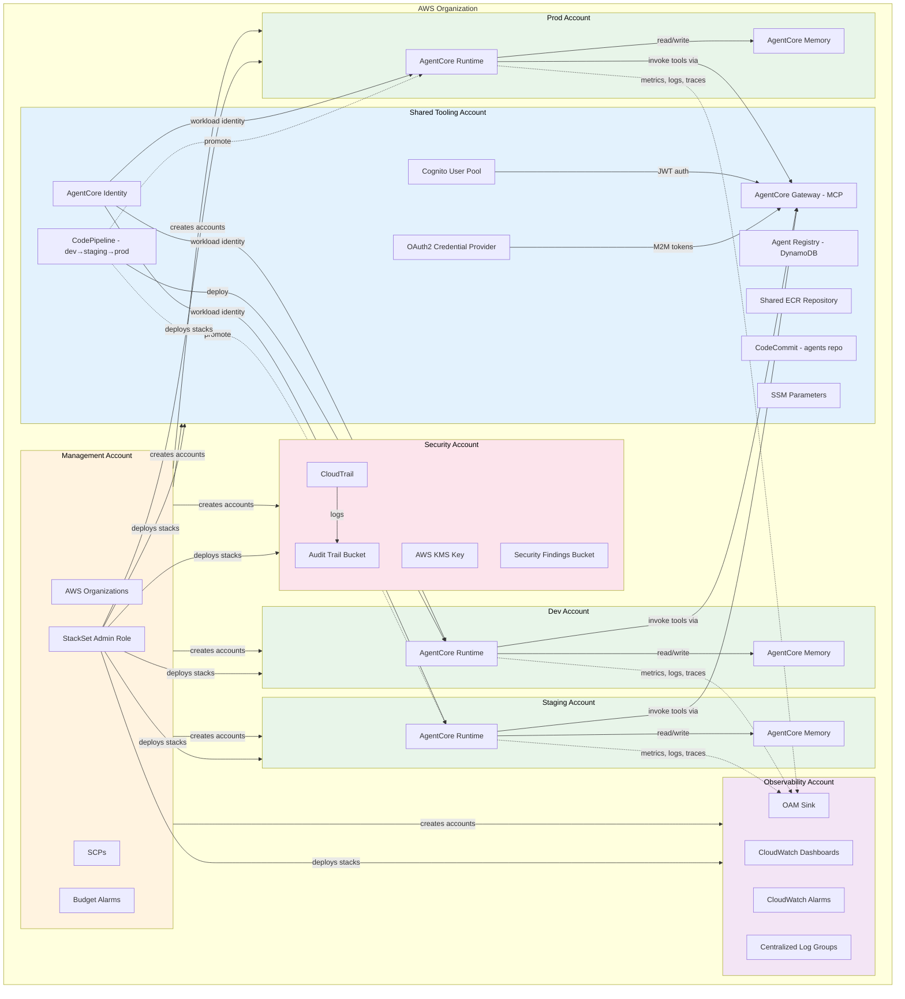
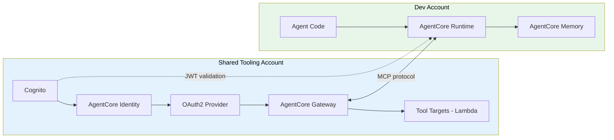
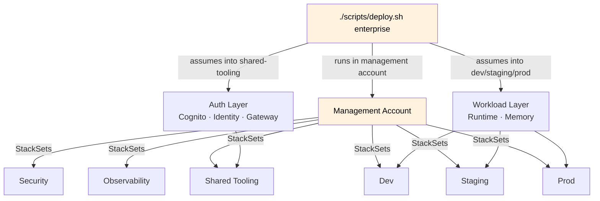

<!-- Copyright Amazon.com, Inc. or its affiliates. All Rights Reserved. -->
<!-- SPDX-License-Identifier: MIT-0 -->

# Architecture

## Enterprise — 7 Account Setup

Management + Security + Observability + Shared-Tooling + Dev + Staging + Prod.

## AgentCore Component Placement

## Component Placement Summary

| Component | Account | Purpose |
|-----------|---------|---------|
| Cognito | Shared Tooling | User pools, M2M auth, OAuth2 flows |
| AgentCore Identity | Shared Tooling | Workload identity, token vault |
| AgentCore Gateway | Shared Tooling | MCP protocol, tool discovery, JWT auth |
| OAuth2 Credential Provider | Shared Tooling | Runtime-to-Gateway authentication |
| AgentCore Runtime | Dev / Staging / Prod | Agent execution (container or zip) |
| AgentCore Memory | Dev / Staging / Prod | Session history, summarization strategies |
| Agent Registry | Shared Tooling | DynamoDB registry of deployed agents |
| Agent Images (ECR) | Shared Tooling | Shared container repository |
| CI/CD Pipeline | Shared Tooling | CodeCommit → CodePipeline → CodeBuild, promotes dev → staging → prod |

## Platform Component Placement

| Component | Account | Purpose |
|-----------|---------|---------|
| AWS Organizations | Management | OUs, SCPs, billing |
| CloudTrail | Security | Audit trail, log validation |
| AWS KMS | Security | Encryption for security data |
| CloudWatch Dashboards | Observability | Agent metrics, latency, token usage |
| CloudWatch Alarms | Observability | Error rate, latency, token budget |
| OAM Sink | Observability | Aggregates metrics, logs, and X-Ray traces from all workload accounts |
| Cross-Account Roles | All | StackSet deployment, telemetry sharing |

## Deployment Flow

Enterprise deploys in a single pass from the management account via `./scripts/deploy.sh enterprise`.

1. Platform stacks are deployed per account via CloudFormation StackSets from the management account.
2. AgentCore auth layer (Cognito, Identity, Gateway) is deployed into shared-tooling.
3. AgentCore workload layer (Runtime, Memory) is deployed into dev, staging, and prod.
4. Agents are deployed as container images or zip packages to AgentCore Runtime via the CI/CD pipeline (CodeCommit → CodePipeline → CodeBuild) owned by shared-tooling.

For single-account, the equivalent entry point is `./scripts/deploy.sh single`, which deploys both the platform CFN stack and the AgentCore CDK stacks into the current account.
